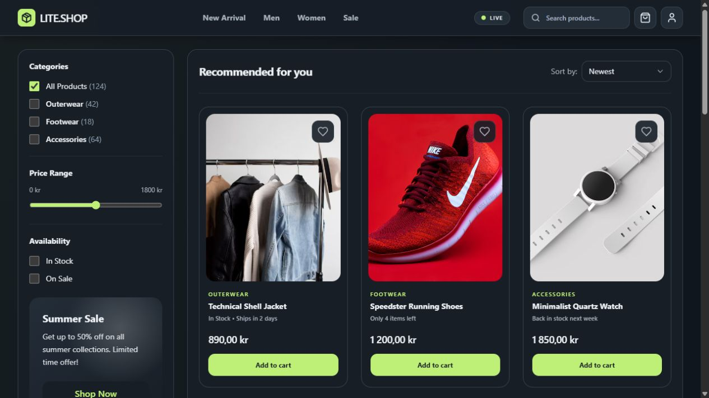

# Interactive Store

Interactive Store is a JavaScript workshop project that turns an online store into a hands-on learning experience. Explore how the page responds to user actions and how the application’s code brings the store experience together.

## About the project

This project offers a practical way to study JavaScript in a familiar setting. Read the source, run the application, and connect its implementation to what you see in the browser.

## Getting started

1. Open the project folder.
2. Check `package.json` for available scripts and setup instructions.
3. If the project has no package scripts, look for an HTML entry point and open it in a browser.

---



---

## Store styling

The page loads `store.css` locally, so the layout does not depend on the browser loading Tailwind from a CDN. The generated stylesheet is included in the project; opening the page with Live Server does not require a build.

After changing Tailwind classes, colors in `tailwind.config.js`, or custom CSS in
`styles.css`, run this command from the workshop folder to regenerate `store.css`:

```shell
npx --yes tailwindcss@3.4.19 --config ./tailwind.config.js --input ./styles.css --output ./store.css --minify
```

Edit the source files rather than the generated `store.css` file.

